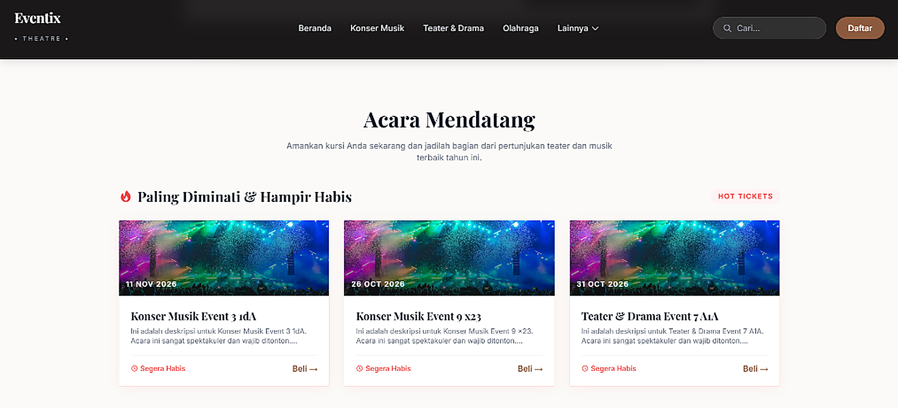

# 🎟️ Eventix Theatre - Event Management System

A professional, full-featured Event Management and Ticketing System built with **Laravel 13** and **FilamentPHP**. This application allows organizers to create events, manage dynamic ticket quotas, seamlessly process payments using the **Midtrans Payment Gateway**, and features an integrated Audit Log system.

---

## 📸 High-Definition Application Preview

<p align="center">
  
</p>

---

## ✨ Key Features

### 🏢 Administrative & Organizer Panel (Powered By Filament v3)
- **Role-Based Access Control (RBAC):** Distinct roles for Super Admin, Organizer, and Scanner using Spatie Permissions.
- **Event & Category Management:** Create and manage events with categories, dates, times, locations, and overall venue capacity.
- **Dynamic Ticket Quotas:** Create multiple ticket tiers (e.g., VIP, Regular). The system automatically validates that the sum of ticket quotas does not exceed the venue's overall capacity.
- **Real-Time Registration Tracking:** Monitor incoming registrations and payment statuses grouped by date and category in an intuitive dashboard.
- **Audit Logging System:** Tracks and records all admin activities (Create, Update, Delete) on Events, Categories, and Tickets to ensure accountability.
- **Human Error Protection:** Strict data-integrity checks prevent admins from accidentally deleting events or ticket types that have already been purchased.

### 👥 User-Facing Frontend (Tailwind CSS)
- **Modern UI:** Clean, responsive, and theater-themed UI for discovering events and purchasing tickets.
- **Search & Filter:** Global search bar for events and robust category filtering directly on the navigation menu.
- **Smart Quota System:** Real-time checking of remaining tickets. Automatically grays out and labels ticket tiers as "Sold Out" when capacity is reached.
- **Google OAuth Login:** One-click authentication with Google for faster checkout and automatic avatar syncing.
- **Profile Management:** Edit profile display names (limited to 1x24h), bio, phone number, and choose custom SVG avatars. 
- **Midtrans Payment Integration:** Fully integrated with Midtrans Snap API for secure, automated, and real-time payment verifications. No manual verification needed.
- **E-Ticket Generation:** Automatically generates a downloadable PDF E-Ticket with a unique **QR Code** upon successful payment.

### 🛡️ Security & Panel Hardening
- **Admin Route Obfuscation & Panel Hardening:** The Filament administrative panel path is not exposed on predictable routes (`/admin`). It is dynamically configured via `ADMIN_PREFIX` in `.env` (default: `eventix-portal-mgmt`). Accessing `/admin` or `/admin/login` returns **HTTP 404 Not Found**, concealing the management suite from malicious bot scans and brute-force attempts.
- **IDOR Protection:** Strict authorization ensuring users can only download and view their own E-Tickets.
- **Webhook Security:** Configured CSRF exceptions for secure Midtrans server-to-server callbacks.
- **Overbooking Prevention:** Transaction-level locks and validation to prevent users and admins from exceeding ticket availability.

---

## 🚀 Technology Stack

- **Backend:** Laravel 13, PHP 8.4+
- **Admin Panel:** Filament v3
- **Frontend:** Tailwind CSS, Blade Templates
- **Authentication:** Laravel Socialite (Google OAuth)
- **Payment Gateway:** Midtrans Snap API
- **PDF Generation:** Barryvdh DomPDF
- **Database:** SQLite (Default) / MySQL / PostgreSQL

---

## 🛠️ Local Installation & Setup Guide

### 1. Repository Cloning
```bash
git clone https://github.com/pranataa-labs/Eventix-Theatre.git
cd Eventix-Theatre
```

### 2. Dependency Installation
```bash
composer install
npm install && npm run build
```

### 3. Environment Setup
```bash
cp .env.example .env
php artisan key:generate
```

### 4. Database Setup & Seeding
Configure your database credentials in the `.env` file, then run:
```bash
php artisan migrate --seed
```
*(Note: The seeder generates the default Admin account, categories, and initial events).*

### 5. Midtrans Configuration
Add your Midtrans API keys in the `.env` file:
```env
MIDTRANS_SERVER_KEY=your-server-key-here
MIDTRANS_CLIENT_KEY=your-client-key-here
MIDTRANS_IS_PRODUCTION=false
ADMIN_PREFIX=eventix-portal-mgmt
```

### 6. Google OAuth Configuration (Optional)
```env
GOOGLE_CLIENT_ID=your-client-id
GOOGLE_CLIENT_SECRET=your-client-secret
GOOGLE_REDIRECT_URL=http://localhost:8000/auth/google/callback
```

### 7. Serve Application
```bash
php artisan serve
```

---

## 🔐 Administrative Access

- **Email:** `admin@admin.com`
- **Password:** `password`
- **Path:** Dynamic based on `ADMIN_PREFIX` (Default: `http://localhost:8000/eventix-portal-mgmt`)

---

## 📄 License

This project is open-sourced software licensed under the [MIT license](https://opensource.org/licenses/MIT).
